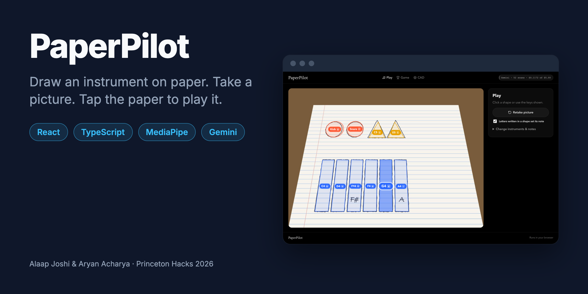
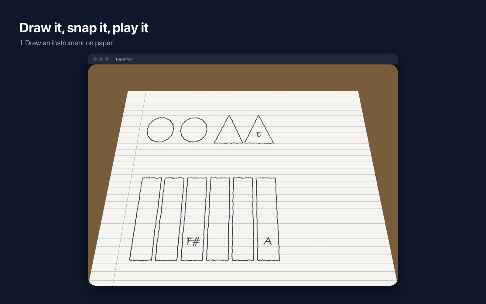
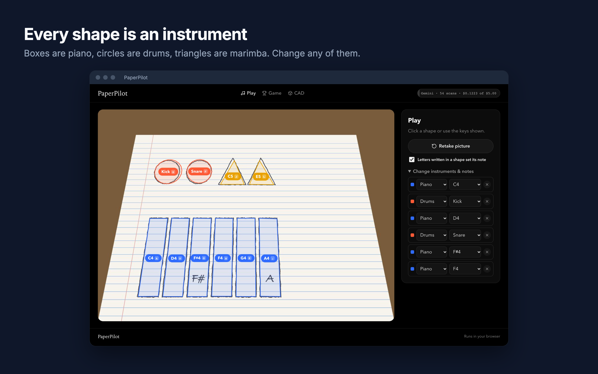
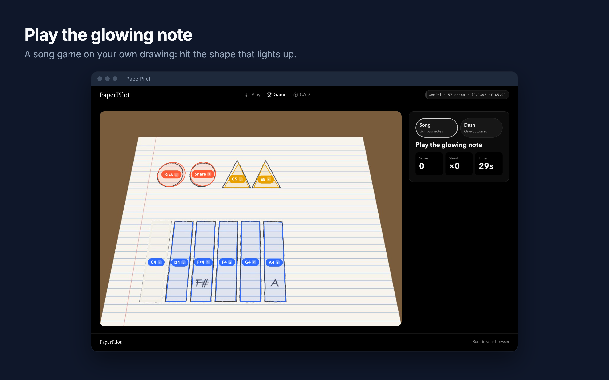
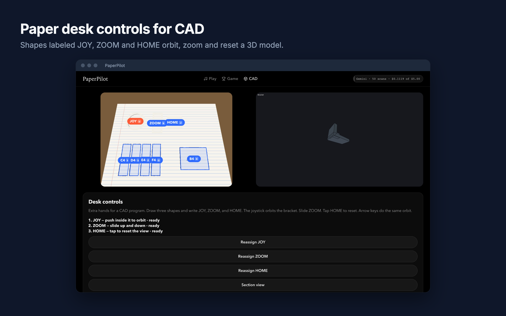
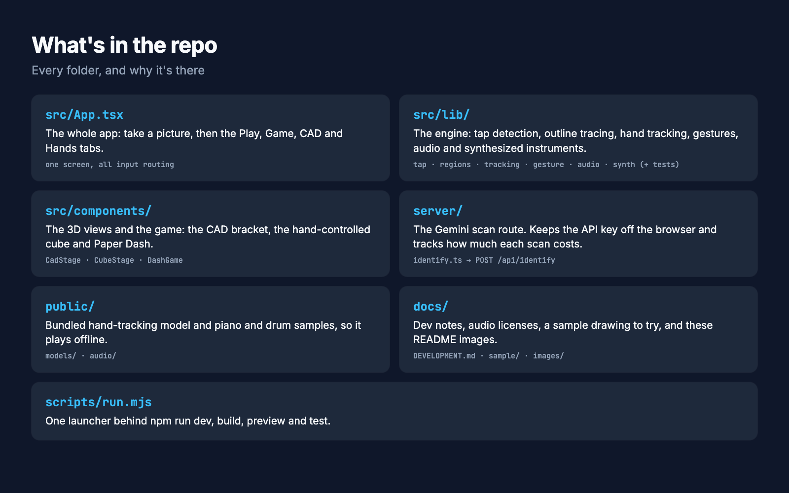

# PaperPilot

> Draw an instrument on paper, take a picture, and play it by tapping the paper. Built for anyone with a laptop, a pen and a webcam.

   

## About
Built with Aryan Acharya at **Princeton Hacks 2026**. Musical instruments and controllers are expensive and not very portable. PaperPilot turns a sheet of paper into one: you draw boxes, circles and other shapes, take one webcam picture, and Google Gemini identifies each shape and any note written inside it. The app then traces the exact outline you drew, places the notes over the live camera feed, and uses MediaPipe hand tracking to detect when a fingertip taps a shape. It helps beginners learn to play an instrument without buying one, and it lets you control CAD and other 3D software with paper or a pinch instead of extra hardware like a 3D mouse.

## Features
- Identifies drawn shapes and handwritten notes from a single webcam picture using Gemini vision with schema-checked JSON output.
- Maps each shape type to an instrument: boxes play piano, circles play drums, triangles play marimba, diamonds play bass and stars play sound effects. Any shape can be reassigned.
- Plays an exact note when one is written inside a shape ("C", "F#", "Bb4"), with a switch to turn that off.
- Detects fingertip taps on the paper with one, two or ten fingers, tuned for a laptop webcam looking down at a desk.
- Includes paper games (a light-up song and a one-button runner) and two CAD demos: paper shapes labeled JOY, ZOOM and HOME that orbit a 3D model, and a Hands mode where thumb-and-index pinches spin, stretch and roll a floating cube.
- Shows Gemini spend live in the app, and keeps the API key on the local server so it never reaches the browser.

## Gallery
<table>
  <tr>
    <td width="50%"> Draw it, snap it, play it: Gemini labels the drawing, then every shape plays.</td>
    <td width="50%"> Every shape is an instrument, and any of them can be changed.</td>
  </tr>
  <tr>
    <td width="50%"> Song game: hit the shape that lights up.</td>
    <td width="50%"> Paper desk controls that orbit, zoom and reset a 3D model.</td>
  </tr>
</table>

## Tech Stack
| Layer | Technology |
|---|---|
| Frontend | React 19, TypeScript, Vite 6, MediaPipe Hand Landmarker, Web Audio API |
| Backend | Node.js route inside the Vite server that calls the Google Gemini API (`@google/genai`) |
| Tools | Vitest, Playwright (for README images) |

## Getting Started

### Prerequisites
- Node.js 22.12+ and npm
- Chrome (camera and Web Audio)
- A webcam (or use **Use a photo instead**)
- Your own Gemini API key from [Google AI Studio](https://aistudio.google.com/apikey). Without one, the app falls back to a basic offline shape finder.

### Installation
~~~bash
git clone https://github.com/alaapjoshi/paperpilot.git
cd paperpilot
npm install
cp .env.example .env.local
# open .env.local and replace your-gemini-api-key-here with your own key
~~~

The key is read only by the local dev server (`server/identify.ts`) and is never sent to the browser. `.env.local` is in `.gitignore`, so it is never committed.

### Usage
~~~bash
npm run dev
~~~

Open http://127.0.0.1:5173 in Chrome and allow the camera.

1. Draw shapes on paper with a dark pen, for example a row of boxes and a few circles. Write a note such as `F#` inside any shape you want on a specific pitch.
2. Point the camera at the sheet and click **Take picture**. After about 2 seconds the notes appear over the live feed.
3. Tap a shape on the paper to play it. You can also click it, or use the keyboard keys shown on each label.
4. Pick **1**, **2** or **10** fingers, or open the **Game**, **CAD** and **Hands** tabs. Hands mode needs no paper: pinch and drag to spin the cube, pinch with both hands to stretch it.

No webcam? Click **Use a photo instead** and choose `docs/sample/sample-drawing.jpg`, or click **Try without paper**.

Other commands:
~~~bash
npm test          # run the unit tests
npm run build     # production build in dist/
npm run preview   # serve the build locally
~~~

## Project Structure

~~~text
paperpilot/
  src/App.tsx           # the app: picture, play, game and CAD tabs, input routing
  src/components/       # 3D views (CAD bracket, hands-controlled cube) and the Paper Dash game
  src/lib/              # tracking, tap detection, outline tracing, audio, synth, geometry (+ tests)
  server/identify.ts    # Gemini scan route and spend tracking, runs inside the Vite server
  public/models/        # MediaPipe hand model and WebAssembly runtime (bundled for offline use)
  public/audio/         # piano samples and drum/sound one-shots
  docs/                 # development notes, audio licenses, sample drawing, README images
  scripts/run.mjs       # launcher for dev, build, preview and test
~~~

## How It Works
1. **Scan.** The browser grabs one camera frame and sends it to `POST /api/identify`. The local server calls Gemini with a JSON schema, asking for each drawn shape's type, outline and any text written inside it.
2. **Trace.** `src/lib/regions.ts` finds every patch of paper enclosed by a pen line and uses it as the exact outline, so slanted keys and wobbly circles match the drawing. A traced outline is used only when it confirms a shape Gemini reported; otherwise Gemini's outline is kept.
3. **Map.** `src/lib/aiLayout.ts` turns shapes into controls: shape type picks the instrument, left-to-right order picks default notes, and written notes override them.
4. **Play.** MediaPipe tracks fingertips on the live feed. `src/lib/tap.ts` reads a tap as a quick downward motion that brakes, then the fingertip is hit-tested against the outlines and Web Audio plays the note before React re-renders.

~~~mermaid
flowchart LR
  Cam[Webcam frame] --> Server[Local Vite server /api/identify]
  Server --> Gemini[Gemini API shapes + labels]
  Gemini --> Trace[Outline tracing regions.ts]
  Trace --> Map[Shapes to instruments aiLayout.ts]
  Live[Live camera] --> Hands[MediaPipe hand tracking]
  Hands --> Tap[Tap detection tap.ts]
  Map --> Hit[Hit test]
  Tap --> Hit
  Hit --> Audio[Web Audio piano + synths]
~~~

## Known Limitations
- Tap detection was tuned on synthetic fingertip traces, not yet measured across many real webcams and desks.
- Diamond and star outlines can come out distorted after shape regularization; rectangles, circles and triangles are reliable.
- The paper and camera must stay still after the picture; if either moves, retake it.
- Scanning needs your own Gemini API key; without one, only a basic offline rectangle finder runs.

## Future Improvements
- Tune tap detection on more webcams and desks; the current thresholds were tuned on synthetic fingertip traces.
- Detect when the paper or camera moves after the picture and re-align automatically instead of asking for a retake.
- Improve outline tracing for faint pencil and gray ruled paper, where the app currently falls back to Gemini's outline.
- Add a hosted demo with a server-side key proxy so it runs without a local install.

## Author
**Alaap Joshi** - Computer Science + Cognitive Science, Rutgers University-New Brunswick
[GitHub](https://github.com/alaapjoshi) | [LinkedIn](https://linkedin.com/in/alaapjoshi)

**Contributors:** Aryan Acharya ([TheAryanAnode](https://github.com/TheAryanAnode))

TODO(Alaap): add the hackathon result and the demo video link.

## License
MIT. See [LICENSE](LICENSE). Bundled piano samples are by Alexander Holm under CC BY 3.0; see [audio licenses](docs/AUDIO-LICENSES.md).
